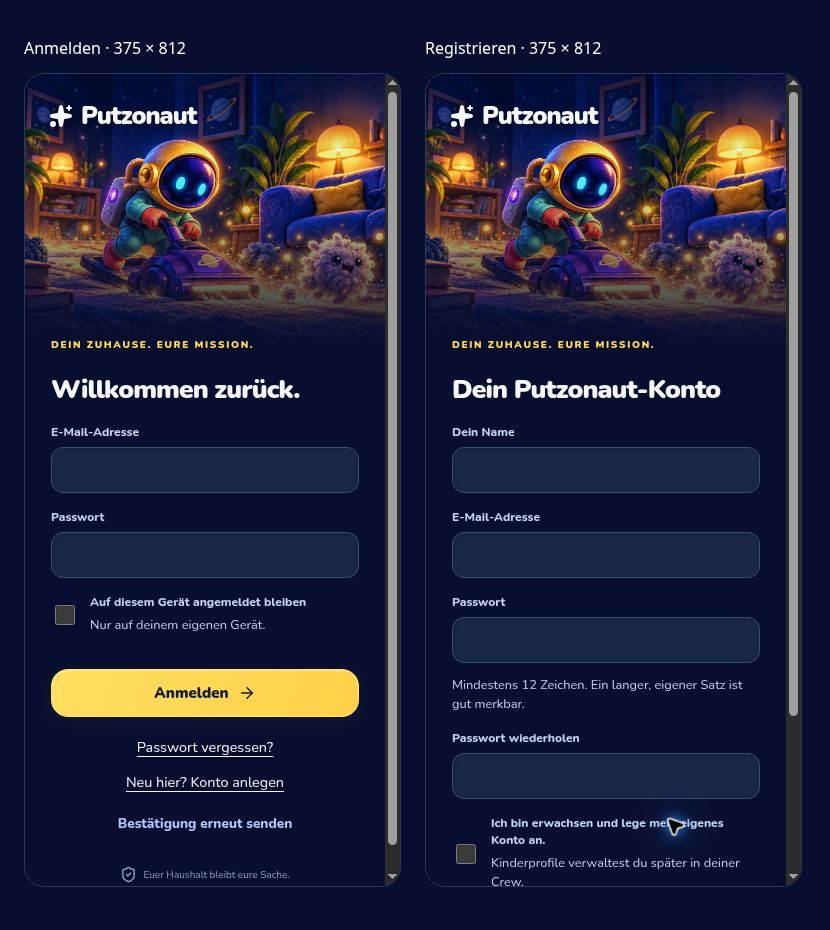

# Prüfstand 0.21.0 · 1. November 2026

## Geprüft

- 314 automatisierte Tests erfolgreich, darunter 16 zusätzliche Tests für den unabhängigen Server und eigene Konten. Keine fehlgeschlagenen oder übersprungenen Tests.
- TypeScript-Prüfung sowie Produktions- und Offline-Build der bestehenden Sites-App erfolgreich.
- Eigenständiger Produktionsbuild erfolgreich. Automatische Prüfung: keine ChatGPT-Anmelde- oder Abmeldepfade im ausgelieferten JavaScript.
- E-Mail-Verifikation, Anmeldung, dauerhafte und temporäre Sitzungscookies, Abmeldung und Ablauf von Sitzungen.
- Passwort-Reset über den tatsächlichen E-Mail-Link, einmalige Verwendung, Widerruf vorhandener Sitzungen sowie Erhalt von Crew, Punkten und Logbuch.
- Gleiche Antworten bei Wiederherstellung für vorhandene und unbekannte E-Mail-Adressen; generische doppelte Registrierung.
- Einmalige Crew-Einladungen, getrennte Haushalte und Schutz von Kinderprofilen.
- Ablehnung gefälschter ChatGPT-Identitäten, ungültiger Cookies, fremder Origins und fremder Rücksprung-URLs.
- HTTP-Grenze: entfernte gefälschte Proxy-/Identitätsheader, begrenzte Request-Größen, sichere Header und geschützte Dateien.
- Serverseitige Begrenzung von Anmeldeversuchen.
- SQLite-Neustart, vollständiges Zurückrollen fehlgeschlagener Batches und genau eine Punktevergabe bei acht gleichzeitigen Abschlussversuchen.
- Verschlüsselte, nach Neustart weiterverwendbare E-Mail-Warteschlange und privater Fotospeicher.
- Explizite Zuordnung übernommener Altprofile: Vorschau ohne Schreiben, Ablehnung unbestätigter/belegter Zielkonten, atomare Anwendung, Erhalt von Crew-/Profil-IDs und Punkten.
- Browserprüfung der Kontoseiten mit unverändertem Putzonaut-Artwork, zugänglichen Beschriftungen und Ansicht bei 375 × 812 CSS-Pixeln. Dafür wurde eine lokale UI-Prüfansicht ohne echte Konten verwendet; Serverabläufe wurden separat gegen die echten HTTP-/Auth-Handler getestet.

Der GitHub-Workflow prüft zusätzlich den gesamten Web-Stand und baut den neuen Docker-Container für linux/amd64 und linux/arm64. Den jeweiligen Laufstatus im Pull Request bzw. unter Actions prüfen.

## Noch vor der Live-Nutzung

Echter Server/Umbrel, HTTPS unter `app.putzonaut.de`, SMTP-Zugang und reale E-Mail-Zustellung sind noch nicht eingerichtet. Die vorhandene private Sites-Testseite bleibt ein eigener Betriebsweg mit ihrer bestehenden Anmeldung. Dieses Update überträgt keine produktiven Datensätze und ändert keine Domain- oder Zugangsfreigabe.

Eine tatsächliche Migration der D1-Daten und R2-Fotos samt anschließender geprüfter Konto-Zuordnung und vollständiger Backup-Wiederherstellung steht noch aus. Web Push benötigt einen eigenen Scheduler für die neue Origin. Kontolöschung und Änderung der Login-E-Mail stehen noch nicht als Selbstbedienung zur Verfügung. Installation und Verhalten auf echten Android-/iPhone-Geräten bleiben gesondert zu prüfen.

Details und Startbefehle: [Eigenständiger Betrieb](../standalone/README.md).
