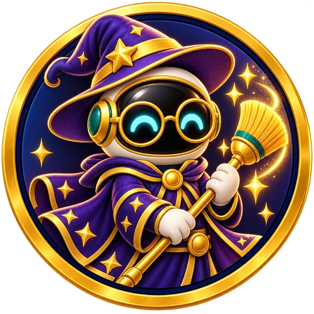
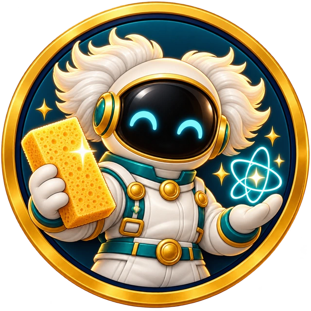

# Abzeichen für Putzonaut 0.12.0

Erstellt am 30.10.2026 mit dem eingebauten Imagegen-Werkzeug. Alle drei Motive wurden einzeln mit `public/art/badge-franz-beckenkehrer.webp` als direkter Stil- und Bearbeitungsreferenz erzeugt. Keine CLI/API-Generierung. Der eigene Putzonaut behält seinen schwarzen Visierbereich und zwei freundlich leuchtende türkise Augen. Die Namenswitze werden durch Kostüme und Requisiten umgesetzt; keine menschlichen Prominentenporträts und keine Schrift im Bild. Die App setzt die Namen als lesbaren Text.

## Galerie

### Harry Putzer



### Albert Reinstein



### Clean Elisabeth


## Gestaltung und Prüfung

Alle drei Medaillen passen zum vorhandenen goldenen runden Rahmen mit dunkelblauem Innenrand. Harry Putzer trägt einen violetten Zauberhut und eine runde Brille und hält einen Besen; Albert Reinstein trägt einen weißen Forscheranzug mit wuscheligen Helmaufsätzen und zeigt Schwamm und Atom-Glanzsymbol; Clean Elisabeth trägt ein lavendelfarbenes königliches Kostüm mit Krone und Perlen und hält ein Poliertuch.

Die erzeugten PNGs mit 1254 × 1254 Pixeln wurden visuell auf Motiv, Figurensprache, Bildgrenzen und fehlende Schrift geprüft. Mit Sharp ausschließlich auf 640 × 640 Pixel verkleinert und in WebP konvertiert: Qualität 92, Alpha-Qualität 100, Aufwand 6. Keine farblichen oder inhaltlichen Nachbearbeitungen. Der echte Alphakanal bleibt erhalten. Alle vier Ecken jeder Datei haben Alpha 0. Die drei fertigen Dateien wurden auch als 96-Pixel-Vorschauen visuell geprüft: Hut/Brille/Besen, weiße Tufts/Schwamm und Krone/Perlen/Winken bleiben unterscheidbar. Dies ist eine Assetprüfung, keine Browserprüfung der App.

| Datei | Größe | Vollständig transparente Pixel | Git-Blob-SHA |
| --- | ---: | ---: | --- |
| `public/art/badge-harry-putzer.webp` | 138.706 Byte | 93.607 | `617c05a49079f35e41c278e70731680c03b96f69` |
| `public/art/badge-albert-reinstein.webp` | 129.026 Byte | 92.464 | `34b4aa645960ad588fbcb3a3f6433685cb7e07f1` |
| `public/art/badge-clean-elisabeth.webp` | 128.072 Byte | 91.795 | `b3049c521924e56704060ef2027ce2a38e55049f` |

Gesamtgröße: 395.804 Byte.

## Vollständige Prompts

### Harry Putzer

Datei: `public/art/badge-harry-putzer.webp`

Modus: Bearbeitung der vorhandenen Franz-Beckenkehrer-Medaille mit echtem transparentem Hintergrund, separater eingebauter Imagegen-Aufruf.

```text
Use case: identity-preserve. Asset type: collectible Putzonaut achievement badge. Edit the reference medal into ONE new matching badge. Keep the SAME circular thick warm gold medal rim, thin navy inner rim, framing, polished tactile enamel and soft metallic materials, cozy premium storybook 3D game illustration, warm amber rim light, mascot helmet proportions and completely black visor with exactly two happy glowing cyan arch eyes. Preserve genuine transparent alpha outside the circular medal. Remove the old crown, laurel, sports costume, broom, soccer ball and ALL previous props; replace only mascot costume, props and inner enamel accents as specified below. Keep the original friendly nonhuman Putzonaut mascot, no visible human face. Strong bold shapes legible at 96 pixels, all props contained inside circular medal. Medal centered with slight transparent safety margin. No text, no letters, no numbers, no labels, no banners, no logos, no watermarks, no political insignia. Theme: HARRY PUTZER, whimsical wizard of cleaning. Original Putzonaut wears a rich deep-violet wizard cape with restrained golden star trim, a large soft bent-tip violet wizard hat on top of astronaut helmet, and simple large round gold spectacles resting in front of the black visor; both cyan happy eyes remain clearly visible through spectacles. Holds one compact golden sweeping broom like a wand, with two or three bright golden clean-sparkles rising from its brush. Navy-to-violet inner enamel field. Cozy magical cleaning, playful confident posture. No football, no crown, no lightning scar, no house emblems, no recognizable human portrait. Hat and broom stay entirely within rim.
```

### Albert Reinstein

Datei: `public/art/badge-albert-reinstein.webp`

Modus: Bearbeitung der vorhandenen Franz-Beckenkehrer-Medaille mit echtem transparentem Hintergrund, separater eingebauter Imagegen-Aufruf.

```text
Use case: identity-preserve. Asset type: collectible Putzonaut achievement badge. Edit the reference medal into ONE new matching badge. Keep the SAME circular thick warm gold medal rim, thin navy inner rim, framing, polished tactile enamel and soft metallic materials, cozy premium storybook 3D game illustration, warm amber rim light, mascot helmet proportions and completely black visor with exactly two happy glowing cyan arch eyes. Preserve genuine transparent alpha outside the circular medal. Remove the old crown, laurel, sports costume, broom, soccer ball and ALL previous props; replace only mascot costume, props and inner enamel accents as specified below. Keep the original friendly nonhuman Putzonaut mascot, no visible human face. Strong bold shapes legible at 96 pixels, all props contained inside circular medal. Medal centered with slight transparent safety margin. No text, no letters, no numbers, no labels, no banners, no logos, no watermarks, no political insignia. Theme: ALBERT REINSTEIN, friendly genius of household cleaning. Original Putzonaut wears a white padded scientist-inspired space suit with a small teal collar, pearl-white round helmet with two exuberant fluffy white swept-out hair-like HELMET attachments at its sides. Keep completely black visor and both happy cyan arch eyes, no face or facial skin. One gloved hand proudly holds a large golden rectangular cleaning sponge, the other presents a single simple glowing teal atomic-orbit-shaped clean sparkle. Navy-to-teal enamel field. Bold symmetrical white tufts and sponge provide clear small-size silhouette. No lab liquids, no mixing chemicals, no flasks, no equations, no text, no broom, no crown, no football.
```

### Clean Elisabeth

Datei: `public/art/badge-clean-elisabeth.webp`

Modus: Bearbeitung der vorhandenen Franz-Beckenkehrer-Medaille mit echtem transparentem Hintergrund, separater eingebauter Imagegen-Aufruf.

```text
Use case: identity-preserve. Asset type: collectible Putzonaut achievement badge. Edit the reference medal into ONE new matching badge. Keep the SAME circular thick warm gold medal rim, thin navy inner rim, framing, polished tactile enamel and soft metallic materials, cozy premium storybook 3D game illustration, warm amber rim light, mascot helmet proportions and completely black visor with exactly two happy glowing cyan arch eyes. Preserve genuine transparent alpha outside the circular medal. Remove the old crown, laurel, sports costume, broom, soccer ball and ALL previous props; replace only mascot costume, props and inner enamel accents as specified below. Keep the original friendly nonhuman Putzonaut mascot, no visible human face. Strong bold shapes legible at 96 pixels, all props contained inside circular medal. Medal centered with slight transparent safety margin. No text, no letters, no numbers, no labels, no banners, no logos, no watermarks, no political insignia. Theme: CLEAN ELISABETH, gracious royal queen of household shine. Original Putzonaut wears a tasteful lavender padded royal space suit with pearl trim, lavender helmet, a small elegant gold crown with lilac jewel on top, and a short delicate row of round pearl-like ornaments along the lower helmet collar. Keep black visor and exactly two happy glowing cyan arch eyes. One rounded gloved hand raised in a gentle royal wave, the other holds a neat teal polishing cloth with one large four-point golden clean sparkle. Navy-to-lavender enamel field. Warm dignified charming posture, graceful round shapes. No football, no broom, no laurel, no epaulettes, no human face or real portrait. Entire crown and hands inside medal.
```


