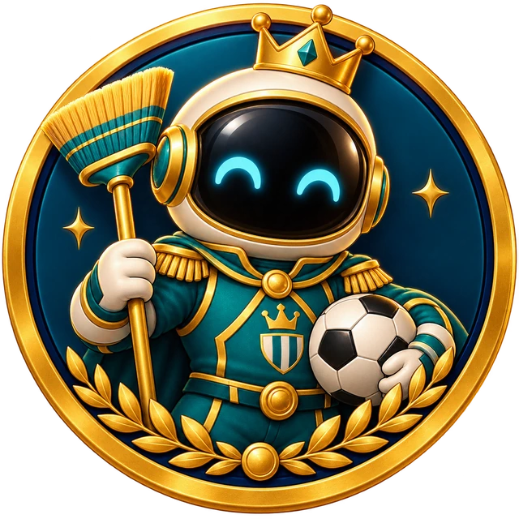
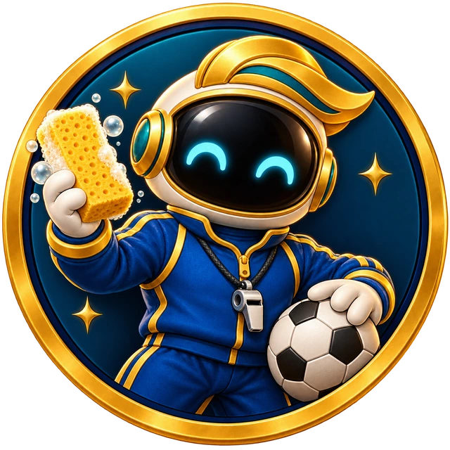
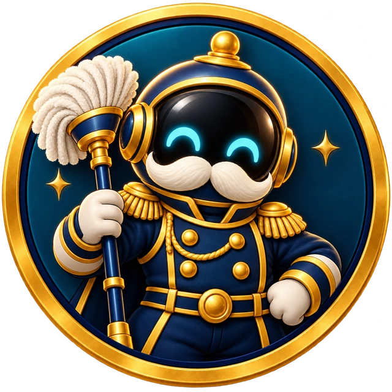

# Abzeichen für Putzonaut 0.9.0

Erstellt am 30.10.2026 mit dem eingebauten Imagegen-Werkzeug. Alle sieben Motive wurden einzeln erzeugt; keine CLI/API-Generierung. Die Namenswitze werden durch Kostüm, Requisiten und Farben des eigenen Putzonauten umgesetzt. Die Illustrationen enthalten keine menschlichen Prominentengesichter und keine Schrift. Die App setzt die Namen als lesbaren Text.

## Galerie

### Franz Beckenkehrer



### Kehrminator


### Jürgen Cleansman



### Helene Wischer


### George Cleaney


### Otto von Wischmark



### Roberto Blanko


## Gestaltung und Prüfung

Alle Abzeichen haben einen goldenen runden Medaillenrahmen mit dunkelblauem Innenrand. Der vertraute Putzonaut behält seinen schwarzen Visierbereich und zwei freundlich leuchtende türkisfarbene Augen. Die Kostüme und Werkzeuge unterscheiden die Erfolge. Das Grundmotiv mit Krone, Besen und Fußball diente als direkte Bearbeitungsreferenz für die sechs weiteren Bilder. Die vorhandenen Dateien `public/art/hero-avatar.webp` und `public/art/hero-avatar-captain.webp` wurden zuvor visuell als Stilreferenz geprüft und bleiben unverändert.

Jedes erzeugte Bild wurde visuell auf passendes Motiv, gleiche Figurensprache, saubere Bildgrenzen und fehlende Schrift geprüft. Die 1254 × 1254 Pixel großen PNGs wurden mit Sharp auf 640 × 640 Pixel verkleinert und als WebP gespeichert (Qualität 92, Alpha-Qualität 100, Aufwand 6). Keine farblichen oder inhaltlichen Nachbearbeitungen. Der echte Alphakanal außerhalb der Medaille bleibt erhalten. Breite, Höhe, Dateigröße, transparente Pixel und alle vier transparenten Ecken wurden an jeder fertigen Datei überprüft. Alle sieben fertigen WebPs wurden zusätzlich als 96-Pixel-Vorschauen visuell geprüft: Die großen Requisiten bleiben in dieser Kartengröße unterscheidbar; im kleinen Profilabzeichen dient vor allem die Farbsilhouette als Wiedererkennung. Die sieben WebPs belegen zusammen 899.338 Byte.

## Vollständige Prompts

### Franz Beckenkehrer

Datei: `public/art/badge-franz-beckenkehrer.webp`

Modus: Neugenerierung mit transparentem Hintergrund.

```text
Use case: stylized-concept. Asset type: collectible achievement badge for the Putzonaut household mission mobile game. Create one centered circular medal emblem on a genuinely transparent background, square canvas. The medal occupies 92 percent of the canvas, with a thick bevelled warm gold outer rim and a thin deep navy inner rim. Inside the badge is a rich deep navy-to-teal enamel field with just two small gold star sparkles. Single central cheerful original Putzonaut mascot, torso portrait filling most of the inner circle: a small rounded astronaut with a big round helmet, completely black glossy visor and exactly two glowing cyan happy upside-down-U eyes, NO mouth or visible human face. Soft padded suit, rounded gloves. Cozy polished premium storybook 3D game illustration, warm amber rim light, tactile enamel and soft metallic materials, playful and elegant. Strong clean silhouette, simple bold details, clear at 96 pixels. Keep all elements inside the circular rim. No outer glow or scene outside the medal; real transparent alpha outside the medal. No text, no letters, no numbers, no labels, no banners, no logo or watermark, no celebrity portrait or likeness.
Theme: FRANZ BECKENKEHRER, a playful royal football sweeping champion. Mascot in a regal teal sports captain suit with gold trim, small friendly golden crown resting atop the astronaut helmet. Holds a compact upright sweeping broom on one side, and a clearly recognizable black-and-white soccer ball tucked under the other glove. A small golden laurel ornament along bottom inside rim. Friendly confident pose, teal/gold accent colors.
```

### Kehrminator

Datei: `public/art/badge-kehrminator.webp`

Modus: Bearbeitung der ersten Franz-Beckenkehrer-Medaille; transparenter Hintergrund beibehalten.

```text
Use case: identity-preserve. Edit this Putzonaut collectible badge into a new matching achievement variant. Keep the SAME circular thick gold medal rim, thin navy inner rim, framing, polish, lighting, high quality cozy storybook 3D style, mascot helmet proportions and black visor with exactly two happy cyan arch eyes. Preserve genuine transparent alpha outside medal. Remove the old crown, all laurel branches, old suit decoration, broom, football and existing props; replace only mascot costume, props and inner enamel accent as described. Do not add a real human face. No text, letters, numbers, banners, logos, watermark or political symbols. Bold simple silhouettes legible at 96 pixels; all props inside circular medal.
Theme: KEHRMINATOR, a friendly futuristic cleaning cyborg. Mascot in chunky brushed silver armor with navy padded joints. Silver astronaut helmet with one small glowing red indicator on the side; keep BOTH happy cyan visor eyes. Holds a compact futuristic upright powered broom with cyan energy ring and a wide soft brush head, clearly a cleaning tool. Navy and silver accents. No weapons, no threatening face, no damage.
```

### Jürgen Cleansman

Datei: `public/art/badge-juergen-cleansman.webp`

Modus: Bearbeitung der ersten Franz-Beckenkehrer-Medaille; transparenter Hintergrund beibehalten.

```text
Use case: identity-preserve. Edit this Putzonaut collectible badge into a new matching achievement variant. Keep the SAME circular thick gold medal rim, thin navy inner rim, framing, polish, lighting, high quality cozy storybook 3D style, mascot helmet proportions and black visor with exactly two happy cyan arch eyes. Preserve genuine transparent alpha outside medal. Remove the old crown, all laurel branches, old suit decoration, broom, football and existing props; replace only mascot costume, props and inner enamel accent as described. Do not add a real human face. No text, letters, numbers, banners, logos, watermark or political symbols. Bold simple silhouettes legible at 96 pixels; all props inside circular medal.
Theme: JÜRGEN CLEANSMAN, an energetic football cleaning coach. Mascot in royal blue sports-coach suit with gold piping and a small silver whistle on a cord. Gold swept-back sculptural helmet fin suggesting a sporty hair swoosh, without real hair or human face. One gloved hand displays a large golden cleaning sponge, other glove rests on black-and-white soccer ball at the lower side. Blue/gold accents. No crown, no laurel, no broom; distinguish from the regal football captain.
```

### Helene Wischer

Datei: `public/art/badge-helene-wischer.webp`

Modus: Bearbeitung der ersten Franz-Beckenkehrer-Medaille; transparenter Hintergrund beibehalten.

```text
Use case: identity-preserve. Edit this Putzonaut collectible badge into a new matching achievement variant. Keep the SAME circular thick gold medal rim, thin navy inner rim, framing, polish, lighting, high quality cozy storybook 3D style, mascot helmet proportions and black visor with exactly two happy cyan arch eyes. Preserve genuine transparent alpha outside medal. Remove the old crown, all laurel branches, old suit decoration, broom, football and existing props; replace only mascot costume, props and inner enamel accent as described. Do not add a real human face. No text, letters, numbers, banners, logos, watermark or political symbols. Bold simple silhouettes legible at 96 pixels; all props inside circular medal.
Theme: HELENE WISCHER, a sparkling joyful household stage performer. Mascot wears a rich violet suit with simple gold sequin stars and violet helmet with gold trim. One gloved hand holds a slim upright mop arranged like a stage microphone stand, unmistakable fluffy white mop strands at the top; other hand open in a welcoming musical pose. Two large decorative golden music-note symbols inside medal field. Violet/gold accents, celebratory graceful pose.
```

### George Cleaney

Datei: `public/art/badge-george-cleaney.webp`

Modus: Bearbeitung der ersten Franz-Beckenkehrer-Medaille; transparenter Hintergrund beibehalten.

```text
Use case: identity-preserve. Edit this Putzonaut collectible badge into a new matching achievement variant. Keep the SAME circular thick gold medal rim, thin navy inner rim, framing, polish, lighting, high quality cozy storybook 3D style, mascot helmet proportions and black visor with exactly two happy cyan arch eyes. Preserve genuine transparent alpha outside medal. Remove the old crown, all laurel branches, old suit decoration, broom, football and existing props; replace only mascot costume, props and inner enamel accent as described. Do not add a real human face. No text, letters, numbers, banners, logos, watermark or political symbols. Bold simple silhouettes legible at 96 pixels; all props inside circular medal.
Theme: GEORGE CLEANEY, a debonair polishing gentleman. Mascot wears an elegant deep navy tuxedo-inspired space suit with crisp pearl lapels and a bold small gold bow tie. Silver metallic swept-back temple inserts on the round helmet suggest a silver-haired gentleman, still completely nonhuman black visor and happy cyan eyes. One gloved hand holds a folded teal microfiber polishing cloth; the other makes a small open-palmed presentation toward one bright four-point clean sparkle. Calm confident pose. Teal/navy/silver accents. No microphone, no football.
```

### Otto von Wischmark

Datei: `public/art/badge-otto-von-wischmark.webp`

Modus: Bearbeitung der ersten Franz-Beckenkehrer-Medaille; transparenter Hintergrund beibehalten.

```text
Use case: identity-preserve. Edit this Putzonaut collectible badge into a new matching achievement variant. Keep the SAME circular thick gold medal rim, thin navy inner rim, framing, polish, lighting, high quality cozy storybook 3D style, mascot helmet proportions and black visor with exactly two happy cyan arch eyes. Preserve genuine transparent alpha outside medal. Remove the old crown, all laurel branches, old suit decoration, broom, football and existing props; replace only mascot costume, props and inner enamel accent as described. Do not add a real human face. No text, letters, numbers, banners, logos, watermark or political symbols. Bold simple silhouettes legible at 96 pixels; all props inside circular medal.
Theme: OTTO VON WISCHMARK, a whimsical old-world admiral of cleaning. Mascot wears a deep navy formal space suit with gold rounded epaulettes. The round navy/gold astronaut helmet has a small smooth rounded golden top ornament, not a sharp spike. A large stylized bushy white moustache is attached OUTSIDE along the lower helmet visor frame, below the cyan eyes, as a playful costume accessory. Holds an upright navy-and-gold mop like a ceremonial staff, with a fluffy white cleaning head clearly visible. Dignified and cute, no human face. No political symbols, no flags, no eagle, no real insignia, no weapons.
```

### Roberto Blanko

Datei: `public/art/badge-roberto-blanko.webp`

Modus: Bearbeitung der ersten Franz-Beckenkehrer-Medaille; transparenter Hintergrund beibehalten.

```text
Use case: identity-preserve. Edit this Putzonaut collectible badge into a new matching achievement variant. Keep the SAME circular thick gold medal rim, thin navy inner rim, framing, polish, lighting, high quality cozy storybook 3D style, mascot helmet proportions and black visor with exactly two happy cyan arch eyes. Preserve genuine transparent alpha outside medal. Remove the old crown, all laurel branches, old suit decoration, broom, football and existing props; replace only mascot costume, props and inner enamel accent as described. Do not add a real human face. No text, letters, numbers, banners, logos, watermark or political symbols. Bold simple silhouettes legible at 96 pixels; all props inside circular medal.
Theme: ROBERTO BLANKO, a joyful laundry showman. Mascot wears a brilliant white tuxedo-inspired padded space suit with golden lapels and a gold bow tie, round pearl-white helmet with gold trim. One glove holds a short handheld microphone with a soft white brush head, and the other displays a fluffy folded white towel. Three large translucent pearly soap bubbles arranged inside the medal field. Warm orange/gold interior accents, exuberant welcoming pose. Keep exactly same original black visor with happy cyan eyes; no human face, no facial skin.
```

